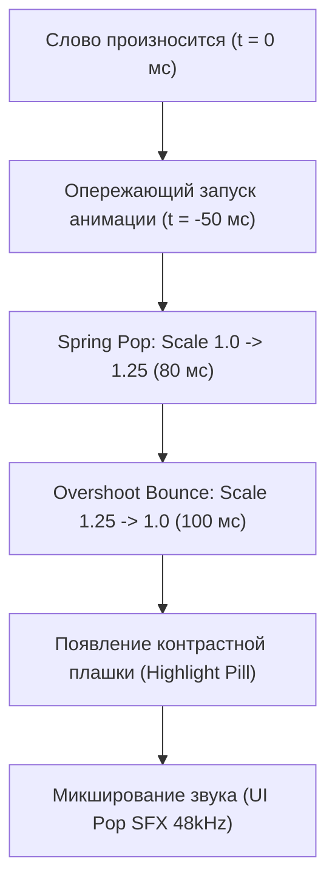

# ⚡ Кинетическая типографика и моушн-текст: Полная база знаний и арсенал (Kinetic Typography Vault 2024–2026)
**Энциклопедическое руководство по открытым движкам, репозиториям, MCP-серверам, математике пружин, алгоритмам вирусных субтитров и стилистическим пресетам**

---

## 📑 Содержание

1. [Архитектура и открытые движки кинетической типографики](#1-архитектура-и-открытые-движки)
   * 1.1 Remotion Core & Captions Ecosystem
   * 1.2 Motion Canvas (Процедурный векторный движок)
   * 1.3 Theatre.js, GSAP & Split-Type
   * 1.4 WebGL / Three.js 3D Typography (Troika & MSDF)
   * 1.5 Python Low-Level Engine (PIL + FFmpeg Pipe)
2. [Реестр открытых GitHub-репозиториев и готовых пресетов](#2-реестр-github-репозиториев-и-пресетов)
3. [MCP-серверы, API и серверная автоматизация](#3-mcp-серверы-api-и-автоматизация)
   * 3.1 Модели принудительного выравнивания (WhisperX & Faster-Whisper)
   * 3.2 Специализированные MCP-серверы (21st, MagicUI, Prompt-Kit, LottieFiles)
   * 3.3 Серверный рендеринг After Effects (Nexrender)
4. [Анатомия и физика вирусных субтитров (CapCut / Submagic / Hormozi)](#4-анатомия-и-физика-вирусных-субтитров)
   * 4.1 Физика пружин (Spring Physics) vs Безье
   * 4.2 Алгоритм динамической плашки (Word Pill Highlight)
   * 4.3 Психоакустика и опережающий акцент (Anticipatory Accent 40–60 мс)
   * 4.4 Защита от слияния с фоном (Multi-layer Stroke & Shadow)
5. [Стилистические архетипы и вариативные шрифты (Variable Fonts)](#5-стилистические-архетипы-и-шрифты)
6. [Готовые формулы, сплайны Безье и конфигурации пружин](#6-готовые-формулы-и-сплайны)
7. [Архитектура нашего автономного пайплайна (Kinetic Video Engine)](#7-архитектура-пайплайна)

---

## 1. Архитектура и открытые движки

```
┌────────────────────────────────────────────────────────────────────────┐
│             ЛАНДШАФТ ДВИЖКОВ КИНЕТИЧЕСКОЙ ТИПОГРАФИКИ (2024–2026)      │
├────────────────────┬────────────────────┬──────────────────────────────┤
│ REACT / REMOTION   │ TYPESCRIPT / CANVAS│ DOM & HEADLESS ANIMATION     │
│ • @remotion/captions│ • Motion Canvas    │ • GSAP 3.x + SplitType       │
│ • @remotion/paths  │ • @motion-canvas/  │ • Theatre.js Core            │
│ • Remotion Lambda  │   ffmpeg           │ • Anime.js v4 (Springs)      │
├────────────────────┼────────────────────┼──────────────────────────────┤
│ 3D / SHADERS WEBGL │ PYTHON LOW-LEVEL   │ AFTER EFFECTS AUTOMATION     │
│ • Troika-three-text│ • PIL/Pillow Pipe  │ • Nexrender (aerender)       │
│ • MSDF Font Atlas  │ • PyAV / NumPy     │ • Adobe ExtendScript JSON    │
│ • Raymarching SDF  │ • FFmpeg HWAccel   │ • MOGRT Template Ingestion   │
└────────────────────┴────────────────────┴──────────────────────────────┘
```

### 1.1 Remotion Core & Captions Ecosystem
Remotion закрепился как индустриальный стандарт для программного видео на базе React и TypeScript.

* **Ключевые пакеты:**
  * `@remotion/captions`: Модуль парсинга субтитров (SRT, VTT, JSON). Поддерживает `createTikTokStyleCaptions` с группировкой слов в динамические страницы и чанки с контролем пауз (`gapThreshold: 300ms`).
  * `remotion`: Примитивы анимации:
    * `spring({ frame, fps, config: { damping, stiffness, mass, overshootClamping } })` — пружинная кинетика отскока.
    * `interpolate(frame, [0, 10], [0, 1], { extrapolateRight: 'clamp', easing: Easing.bezier(...) })`.
  * `@remotion/layout-utils`: Серверное вычисление габаритов (`measureText`) без рендера в реальный DOM браузера. Это позволяет на лету рассчитывать ширину фоновой плашки (Highlight Pill) и избегать скачков макета (Layout Shift).
  * `@remotion/paths`: Анимация векторных контуров букв (`evolvePath`), морфинг типографики в геометрические фигуры и неоновые росчерки.
* **Масштабирование:**
  * **Remotion Lambda (AWS):** Нарезка видео на чанки по 2–4 секунды, параллельный рендер на сотнях лямбда-функций в контейнерах Chromium. 60-секундный ролик 1080x1920 60 FPS рендерится за 4–7 секунд.

### 1.2 Motion Canvas (Процедурный векторный движок)
* **Репозиторий:** `motion-canvas/motion-canvas` (GitHub, сайт [motioncanvas.io](https://motioncanvas.io/))
* **Концепция:** Создание анимации математической точности через **ES6-генераторы** (`function* () { yield* all(...); }`) и систему реактивных сигналов.
* **Кинетическая типографика:**
  * Узел `Txt`: Встроенный контроль `letterSpacing`, `wordWrap`, `lineHeight`, `fontFamily`.
  * Каскадная анимация: Посимвольная и пословная разбивка с управляемым временным сдвигом (`delay(index * 0.03)`).
  * Экспорт: Высокоскоростной экспорт в WebM/PNG-секвенции и прямой рендеринг через `@motion-canvas/ffmpeg`.

### 1.3 Theatre.js, GSAP & Split-Type
* **Theatre.js (`theatre-js/theatre`):**
  * Визуальный интерфейс таймлайна (Theatre Studio) + сверхлегковесный headless-рантайм (`@theatre/core`).
  * Позволяет настраивать сложные пространственные кривые и хореографию текста в UI, а затем подставлять динамический текст программно через JSON в headless-режиме.
* **GSAP (GreenSock) & Split-Type (`lmgonzalves/split-type`):**
  * Бесплатная связка для пословной (`.words`) и посимвольной (`.chars`) кинетики.
  * Плавное перемещение слов между строками через `Flip Plugin` (First, Last, Invert, Play).
* **Anime.js (v4):**
  * Полная поддержка пружинной физики (`spring(mass, stiffness, damping, velocity)`), независимый рендер-луп без привязки к `window.requestAnimationFrame`, что позволяет рендерить кинетику на сервере в Node.js.

### 1.4 WebGL / Three.js 3D Typography (Troika & MSDF)
* **Troika-three-text (`protectwise/troika`):**
  * Лидер для 3D-текста в WebGL. На лету генерирует Signed Distance Fields (SDF) в фоновом Web Worker из файлов TTF/OTF/WOFF.
  * Абсолютная четкость при любом угле обзора и зуме, поддержка кастомных GLSL-шейдеров (волновой шум Перлина, изгиб текста по трехмерной кривой, плавление).
* **MSDF (Multi-channel Signed Distance Fields):**
  * В отличие от обычного 1-канального SDF, сохраняет идеально острые углы шрифтов даже на экстремально малых текстурных атласах.
* **Raymarching / SDF GLSL Shaders:**
  * Математический рендер объема без сетки полигонов: слияние букв (`smin`), хроматическая аберрация, неоновый блум и преломление света.

### 1.5 Python Low-Level Engine (PIL + FFmpeg Pipe)
Архитектура, реализованная в нашем скрипте `build_ultra_fast_kinetic_reel.py`:
* **Прямой пайплайн в память:** Отрисовка кадров в Pillow (`ImageDraw`) с наложением бруталистских плашек и типографики.
* **Zero-Disk I/O:** Сырые байты RGBA передаются напрямую в stdin процесса FFmpeg через `pipe:0`:
  ```bash
  ffmpeg -f rawvideo -pix_fmt rgba -s 1080x1920 -r 60 -i pipe:0 \
         -c:v h264_videotoolbox -b:v 20M -pix_fmt yuv420p output.mp4
  ```
* Скорость генерации: свыше 100–140 кадров в секунду на чипах Apple Silicon.

---

## 2. Реестр GitHub-репозиториев и пресетов

| Проект | Стек | Описание и фичи | Ссылка |
| :--- | :--- | :--- | :--- |
| **`vshukla7/remotion-captions-themes`** | TypeScript, React, Remotion | Набор готовых тем для вирусных субтитров: `kinetic-01`, `pop`, `karaoke`, `hustle`, неоновые плашки. | [GitHub](https://github.com/vshukla7/remotion-captions-themes) |
| **`udaykirancodes/kinetic-studio`** | Next.js, Remotion, Tailwind | Полноценная веб-студия для превращения текста в кинематическую типографику с аудио-синхронизацией. | [GitHub](https://github.com/udaykirancodes/kinetic-studio) |
| **`waseemnasir2k26/reelforge`** | Python, faster-whisper, FFmpeg | Локальный опенсорс-аналог Submagic и Opus Clip: автонарезка, пословное выделение, наложение стилей. | [GitHub](https://github.com/waseemnasir2k26/reelforge) |
| **`floomhq/opencut`** | Whisper, Remotion, React | Движок автоматического монтажа клипов для соцсетей с кинетическим текстом. | [GitHub](https://github.com/floomhq/opencut) |
| **`reactvideoeditor/remotion-templates`** | Remotion, React | Каталог из 80+ готовых видео-шаблонов (Bounce Text, Glitch Type, Typewriter, Pop Captions). | [GitHub](https://github.com/reactvideoeditor/remotion-templates) |
| **`lifeprompt-team/remotion-scenes`** | Remotion, Three.js | 200+ профессиональных моушн-сцен, титров и переходов. | [GitHub](https://github.com/lifeprompt-team/remotion-scenes) |
| **`iart-ai/kinetic-typography-skills`** | Claude / AGY Skills, GSAP | Набор навыков для ИИ-агентов по генерации бит-синхронизированного кинетического текста. | [GitHub](https://github.com/iart-ai/kinetic-typography-skills) |
| **`DanteAlighieri13210914/pv-tool`** | PixiJS, TypeScript | Браузерный VFX-движок для создания PV-клипов и динамичных лирик-видео с кинетикой. | [GitHub](https://github.com/DanteAlighieri13210914/pv-tool) |
| **`nicolaigaina/ai-video-captions`** | Python, Whisper, FFmpeg | Докеризированный инструмент генерации субтитров в стиле Alex Hormozi и MrBeast. | [GitHub](https://github.com/nicolaigaina/ai-video-captions) |
| **`inlife/nexrender`** | Node.js, After Effects CLI | Автоматический серверный рендеринг After Effects проектов через динамические JSON-данные. | [GitHub](https://github.com/inlife/nexrender) |

---

## 3. MCP-серверы, API и автоматизация

### 3.1 Модели принудительного выравнивания (Word-Level Forced Alignment)

Для точной кинетики критически важно знать точные миллисекунды старта и конца каждого слова:

1. **WhisperX (Self-Hosted GPU Pipeline):**
   * Связка: базовая модель Whisper + фонетическое выравнивание через `wav2vec2` / `torchaudio` + голосовой детектор активности `Silero-VAD`.
   * **Точность:** 10–20 миллисекунд (устраняет дрейф таймингов и галлюцинации пауз).
2. **Faster-Whisper:**
   * Движок на базе CTranslate2. До 4 раз быстрее оригинального Whisper при минимальном потреблении VRAM.
3. **Deepgram Nova-3 API:**
   * Облачное API с задержкой менее 300 мс и непревзойденной точностью распознавания русских и английских терминов.
4. **AssemblyAI Conformer-2:**
   * Облачное распознавание с автодетекцией спикеров и ключевых смысловых акцентов.

### 3.2 Специализированные MCP-серверы для кинетического текста

* **MCP `21st` (`https://21st.dev/api/mcp`):**
  * Облачная сборка таймлайна, пресеты кинетических блоков, динамическая подстановка текста, наложение аудиодорожек и экспорт видео через `video_apply_ops`.
* **MCP `magicui` (`@magicuidesign/mcp`):**
  * Доступ к анимированным React-компонентам:
    * `LetterPullUp`: кинетический взлёт букв снизу вверх.
    * `WordRotate`: 3D-вращение слов по оси X.
    * `SparklesText`: акцентное мерцание ключевых фраз.
    * `VelocityScroll`: бегущий тикер с кинетическим ускорением.
* **MCP `prompt-kit` (`shadcn@canary`):**
  * Интерфейсные моушн-примитивы и динамические текстовые блоки.
* **MCP `lottiefiles` (Local stdio):**
  * Векторные оверлеи (акцентные стрелки, подчеркивания, маркерные обводки слов, взрывы конфетти), синхронизируемые с ключевыми словами.

### 3.3 Серверный рендеринг After Effects (Nexrender)
Архитектура `inlife/nexrender`:
* Позволяет подключить рабочий моушн-шаблон `.aep` с профессиональными выражениями (After Effects Expressions: `linear(time, inPoint, outPoint, 0, 100)`).
* Серверный демон принимает JSON с массивом слов и таймкодов, автоматически подставляет их в слои и рендерит через headless `aerender` в фоновом режиме.

---

## 4. Анатомия и физика вирусных субтитров (CapCut / Submagic / Hormozi)



### 4.1 Физика пружин (Spring Physics) vs Безье

В кинетическом дизайне линейные анимации строго запрещены. Движение описывается дифференциальным уравнением затухающих колебаний:

$$m \frac{d^2 x}{dt^2} + c \frac{dx}{dt} + k x = 0$$

где:
* $m$ — масса объекта (`mass`),
* $c$ — коэффициент сопротивления/демпфирования (`damping`),
* $k$ — жесткость пружины (`stiffness`).

**Коэффициент затухания (Damping Ratio):**
$$\zeta = \frac{c}{2 \sqrt{k \cdot m}}$$

* **Субкритическое затухание ($\zeta \approx 0.65 - 0.72$):** Создает фирменный сочный отскок («эффект резинки»), ключевой для стиля Hormozi / Submagic. Слово слегка вылетает за свой финальный размер и пружинит назад.
* **Критическое затухание ($\zeta = 1.0$):** Максимально быстрое перемещение без колебаний (идеально для ухода текста с экрана).

### 4.2 Алгоритм динамической плашки (Word Pill Highlight)
1. Вычисление точных габаритов активного слова через `measureText(font, word)`.
2. Добавление внутренних отступов: `paddingX = 14px`, `paddingY = 8px`.
3. Отрисовка скругленного прямоугольника (`border-radius: 8px` в швейцарском стиле или `14px` в стиле поп-арт).
4. Цвет плашки: высококонтрастный кислотный желтый (`#FFE600`), салатовый (`#00FF66`) или электро-циан (`#00E5FF`). Текст внутри плашки инвертируется в абсолютно черный (`#000000`).

### 4.3 Психоакустика и опережающий акцент (Anticipatory Accent 40–60 мс)
* **Золотое правило моушн-дизайна:** Визуальная анимация слова обязана стартовать на **40–60 миллисекунд раньше** фактического звукового удара в аудиодорожке.
* **Физиологическая причина:** Зрительная кора человеческого мозга обрабатывает зрительный образ на 30–50 мс медленнее, чем слуховая кора обрабатывает звук. Если запустить анимацию строго по таймкоду звука, у зрителя возникнет ощущение, что субтитры опаздывают. Опережающий показ создает идеальную синестезию звука и картинки.

### 4.4 Защита от слияния с фоном (Multi-layer Stroke & Shadow)
Чтобы текст читался на любом видеоряде (белый снег, пестрый город, темная комната):
1. **Толстый контур (Stroke):** `-webkit-text-stroke: 4px #000000; paint-order: stroke fill;`.
2. **Многослойная тень:**
   * Слой 1 (жесткий отступ): `0px 4px 0px #000000` (комиксная четкость).
   * Слой 2 (мягкое рассеивание): `0px 8px 24px rgba(0, 0, 0, 0.75)`.

---

## 5. Стилистические архетипы и шрифты

### 5.1 Архетипы моушн-стилей

| Архетип | Шрифтовой стек | Палитра | Механика кинетики |
| :--- | :--- | :--- | :--- |
| **Swiss Kinetic** (Швейцарский стиль) | Neue Haas Grotesk, Helvetica Now, Inter, Uncut Sans | Черный, чистый белый, International Klein Blue, Swiss Red | Идеальные кривые Безье, маскирование строк (overflow hidden mask-reveal), каскадный сдвиг (stagger 40 мс) |
| **Brutalist / Industrial** | Druk Wide, PP Neue Montreal, Syne, Monument Extended, JetBrains Mono | Черный, флуоресцентный лайм (`#D4FF00`), хот-пинк (`#FF0055`) | Резкие шаги без сглаживания (Snap/Step), инверсия плашек, горизонтальный тикер, жесткие тени |
| **Cyberpunk / Tactical HUD** | Space Mono, OCR-A, PP Mondwest, Share Tech Mono | Глубокий темно-графитовый, неоновый циан (`#00FFFF`), матричный зеленый (`#00FF66`) | Терминальный набор (Typewriter 30 мс/буква), глитчи (RGB Split), прицелы, радары, телеметрия |
| **Kinetic Editorial** | PP Woodland, Editorial New, Ogg, Playfair Display | Сложные пастели, глубокий бордо, изумруд, монохром | Плавный пружинный подъем, динамический наклон курсива (dynamic slant), смена Regular ↔ Italic в такт речи |

### 5.2 Вариативные шрифты (Variable Fonts) в реальном времени
Использование осей вариативности шрифтов для органической кинетики:
* Ось веса (`'wght' 100 -> 900`): Модулируется амплитудой громкости голоса спикера (RMS Volume). Громкое слово буквально становится жирнее.
* Ось ширины (`'wdth' 75 -> 125`): Растяжение слова при акцентах и паузах.
* Ось наклона (`'slnt' 0 -> -12`): Динамический курсив при эмоциональных интонациях.

---

## 6. Готовые формулы и сплайны

### 6.1 Пресеты Cubic-Bezier для CSS / Remotion

```typescript
// 1. Фирменный отскок слова (Pop & Overshoot)
const EASE_POP_OVERSHOOT = Easing.bezier(0.175, 0.885, 0.32, 1.275);

// 2. Резкий бруталистский удар (Snappy Staccato)
const EASE_SNAPPY_STACCATO = Easing.bezier(0.85, 0, 0.15, 1);

// 3. Откат назад перед броском (Anticipation / Back-In)
const EASE_ANTICIPATION = Easing.bezier(0.36, 0, 0.66, -0.56);

// 4. Ультраплавное раскрытие (Ultra-smooth Quint Out)
const EASE_EDITORIAL_REVEAL = Easing.bezier(0.16, 1, 0.3, 1);
```

### 6.2 Конфигурации пружин Remotion Spring

```typescript
// Появление слова в стиле Submagic (сочный упругий отскок)
export const SPRING_WORD_POP = {
  damping: 12,
  stiffness: 180,
  mass: 0.8,
  overshootClamping: false,
};

// Плавный затухающий подъем (Editorial)
export const SPRING_SMOOTH_FLOAT = {
  damping: 24,
  stiffness: 120,
  mass: 1.0,
  overshootClamping: true,
};

// Тяжелый индустриальный удар (Brutalist Impact)
export const SPRING_HEAVY_SLAM = {
  damping: 18,
  stiffness: 300,
  mass: 2.2,
  overshootClamping: false,
};
```

---

## 7. Архитектура нашего автономного пайплайна (Kinetic Video Engine)

```
┌────────────────────────────────────────────────────────────────────────┐
│             СКВОЗНОЙ КОНВЕЙЕР ПРОИЗВОДСТВА КИНЕТИЧЕСКИХ РОЛИКОВ        │
└──────────────────────────────────┬─────────────────────────────────────┘
                                   │
                                   ▼
          ┌─────────────────────────────────────────────────┐
          │ 1. ИСХОДНЫЙ АУДИО/ВИДЕО ТРЕК                   │
          │    (Голос диктора NotebookLM или спикер)        │
          └────────────────────────┬────────────────────────┘
                                   │
                                   ▼
          ┌─────────────────────────────────────────────────┐
          │ 2. WHISPERX / FASTER-WHISPER                    │
          │    Фонетическое выравнивание слова до 10 мс     │
          │    Выход: words_timeline.json                   │
          └────────────────────────┬────────────────────────┘
                                   │
                                   ▼
          ┌─────────────────────────────────────────────────┐
          │ 3. SEMANTIC AI ENRICHMENT (LLM / MCP)           │
          │    • Детекция ударных слов                      │
          │    • Маппинг цветов (#FFE600, #FF0055)          │
          │    • Назначение SFX (pop.wav, lock.wav)         │
          │    • Подбор Lottie-маркеров и эмодзи            │
          └────────────────────────┬────────────────────────┘
                                   │
                                   ▼
          ┌─────────────────────────────────────────────────┐
          │ 4. ГЕНЕРАТОР КИНЕТИКИ                           │
          │    • Вариант А: Fast Python Engine (PIL+Pipe)   │
          │    • Вариант Б: Remotion Headless (React+WebGL) │
          │    • Опережение тайминга: -50 мс                │
          │    • Пружины: damping=12, stiffness=180         │
          └────────────────────────┬────────────────────────┘
                                   │
                                   ▼
          ┌─────────────────────────────────────────────────┐
          │ 5. КОМПОЗИТИНГ И ЗВУКОРЕЖИССУРА (FFmpeg)        │
          │    • Бленд кинетики: blend=screen / over        │
          │    • Сведение звука: SFX + Голос (-14 LUFS)     │
          │    • Аппаратное ускорение: Apple Silicon        │
          └────────────────────────┬────────────────────────┘
                                   │
                                   ▼
          ┌─────────────────────────────────────────────────┐
          │ 6. TELEGRAM REVIEW GATE BOT                     │
          │    Мгновенная отправка MP4 Михаилу на ревью     │
          └─────────────────────────────────────────────────┘
```

---
*Документ подготовлен как фундаментальный инженерный базис видеопроизводства в экосистеме Михаила Пузырёва.*
